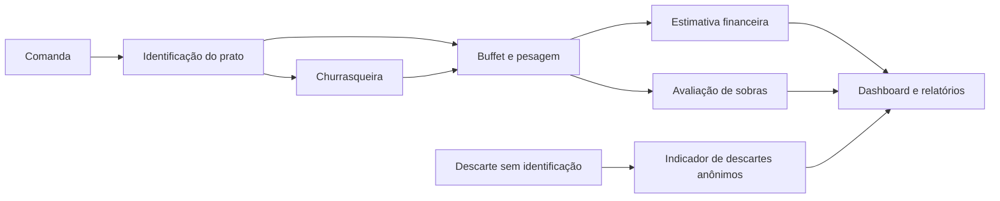
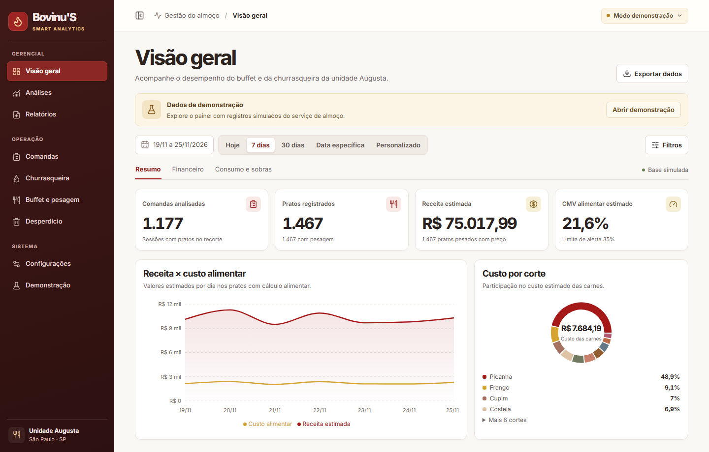
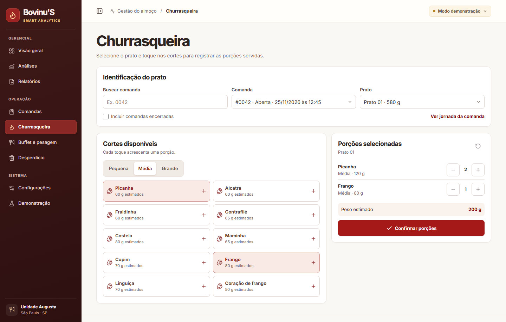
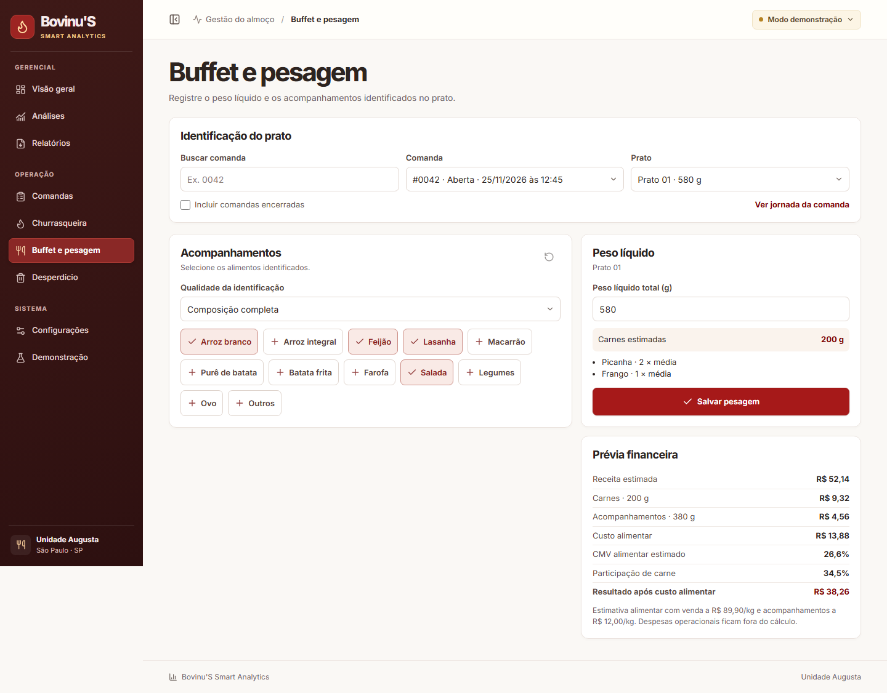
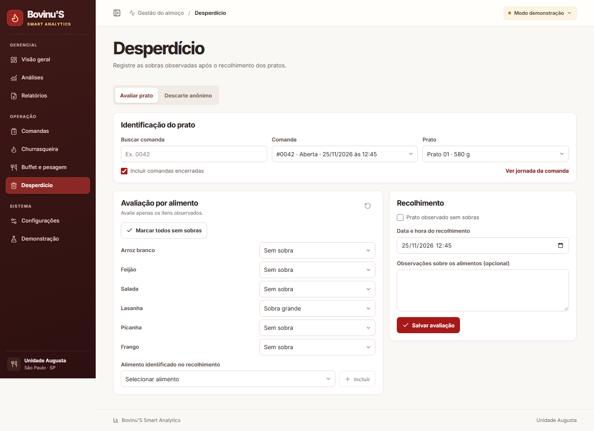
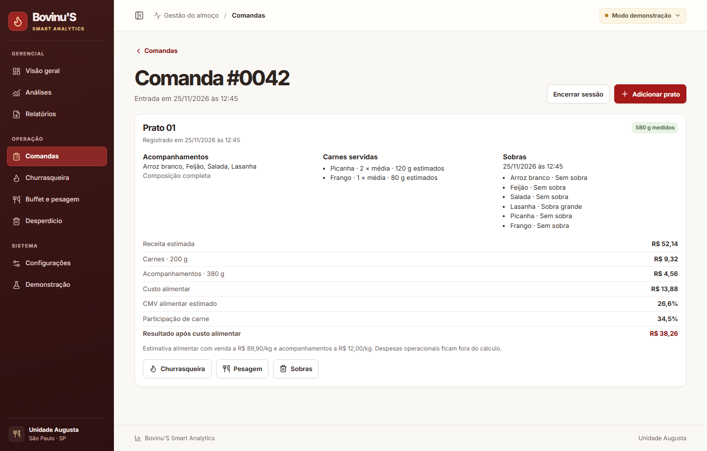
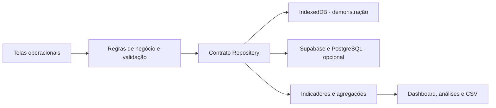
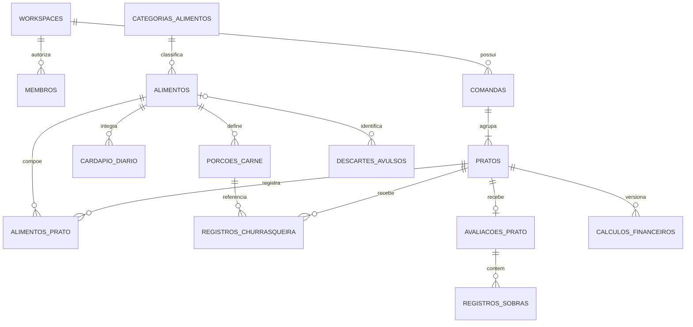

# Bovinu'S Smart Analytics

> **Do prato à decisão.**

## Apresentação do projeto

Protótipo de Hackathon universitário desenvolvido para o **Bovinu'S Grill & Beer — Unidade Augusta**. A aplicação conecta os registros do serviço de almoço para estimar o custo alimentar, entender as escolhas dos clientes e acompanhar as sobras observadas.

## Links de acesso rápido

- [Vídeo demonstrativo — apresentação prática da solução.](https://drive.google.com/file/d/1coZVVtrhQtsyTc2HeheuDNx_EOpSLxDe/view?usp=drive_link)
- [Apresentação oficial em PowerPoint](docs/apresentacao-bovinus-smart-analytics.pptx) · [Apresentação oficial em PDF](docs/apresentacao-bovinus-smart-analytics.pdf)
- [Capturas do sistema](#capturas-de-tela) · [Demonstração da comanda 0042](#demonstração-prática) · [Instruções de execução](#instruções-de-execução)
- [Código-fonte](src/) · [Migrations PostgreSQL](supabase/migrations/)

## Problema identificado

A pesagem informa quanto o cliente se serviu. O peso isolado deixa em aberto a composição do prato, o custo das porções e os alimentos que voltam como sobra. Essas informações dispersas dificultam a identificação de padrões por alimento, corte de carne e horário.

## Solução proposta

O sistema relaciona comanda, prato, porções, pesagem e sobras. O dashboard apresenta a evolução dos custos, as escolhas do buffet e a cobertura das avaliações. A coleta pode ser feita por amostragem, dispensa câmeras e se encaixa no atendimento self-service. A integração com as comandas eletrônicas é simulada no MVP.

## Dores atendidas

| Pergunta da operação | Informação disponível |
| --- | --- |
| O que os clientes escolhem? | Alimentos mais e menos escolhidos entre os disponíveis e cortes mais solicitados |
| Quanto custa servir um prato? | Receita, custo alimentar e CMV estimados por prato |
| Quais carnes mais impactam o custo? | Participação de cada corte no custo estimado e demanda por horário |
| Quais alimentos mais sobram? | Frequência e intensidade de sobra por alimento, com tamanho da amostra |
| Quais padrões merecem atenção? | Comparação entre períodos, alertas descritivos e matriz de popularidade e aceitação |

## Etapas de desenvolvimento

1. Mapeamos a jornada do cliente e identificamos os pontos de coleta.
2. Modelamos comandas, pratos, alimentos, porções e sobras.
3. Implementamos os registros operacionais e os cálculos financeiros.
4. Conectamos o dashboard aos registros e testamos a jornada completa no navegador.

## Jornada do cliente

Uma comanda pode reunir vários pratos. O identificador de cada prato conecta as informações coletadas pelas diferentes frentes.



## Funcionalidades

| Módulo | O que permite fazer |
| --- | --- |
| Comandas | Criar e encerrar sessões simuladas, vincular múltiplos pratos e consultar o histórico |
| Churrasqueira | Registrar, revisar e confirmar porções por corte e tamanho |
| Buffet e pesagem | Identificar acompanhamentos, informar o peso líquido e consultar a prévia financeira |
| Desperdício | Avaliar sobras por item, registrar avaliações parciais e corrigir descartes anônimos |
| Dashboard e análises | Filtrar registros, comparar receita e custo, consultar rankings, insights e a matriz |
| Relatórios | Consultar e exportar o recorte em CSV de pratos, alimentos ou descartes |
| Configurações e demonstração | Ajustar cardápio, pesos, custos e indicadores, percorrer a comanda 0042 e restaurar a base simulada |

## Capturas de tela

As cinco capturas foram feitas no aplicativo em modo demonstração. As telas operacionais mostram a comanda 0042.



<details>
<summary>Churrasqueira</summary>



</details>

<details>
<summary>Buffet e pesagem</summary>



</details>

<details>
<summary>Registro de sobras</summary>



</details>

<details>
<summary>Detalhamento da comanda</summary>



</details>

## Vídeo demonstrativo

[**Vídeo demonstrativo — apresentação prática da solução.**](https://drive.google.com/file/d/1coZVVtrhQtsyTc2HeheuDNx_EOpSLxDe/view?usp=drive_link)

### Demonstração prática

**Comanda 0042 — Prato 01**

Duas porções médias de picanha, uma porção média de frango, arroz branco, feijão, salada e lasanha. A lasanha foi registrada com **sobra grande**. Os demais itens foram registrados **sem sobra**.

| Indicador | Valor demonstrativo |
| --- | ---: |
| Peso líquido total | 580 g |
| Receita estimada | R$ 52,14 |
| Custo estimado das carnes | R$ 9,32 |
| Custo estimado dos acompanhamentos | R$ 4,56 |
| Custo alimentar total estimado | **R$ 13,88** |
| Resultado após custo alimentar | R$ 38,26 |
| CMV alimentar estimado | 26,6% |

O mesmo prato conecta churrasqueira, buffet, pesagem e desperdício. Depois de registrar as sobras na tela **Demonstração**, a ação **Ver impacto no dashboard** abre o painel filtrado pela comanda. O resultado de R$ 38,26 representa a receita estimada menos o custo dos alimentos. Despesas operacionais ficam fora desse cálculo.

## Apresentação oficial

[Baixar PowerPoint](docs/apresentacao-bovinus-smart-analytics.pptx) · [Abrir versão em PDF](docs/apresentacao-bovinus-smart-analytics.pdf)

A apresentação oficial contém cinco slides.

1. Bovinu'S Smart Analytics — Do prato à decisão.
2. Etapas de desenvolvimento do projeto.
3. Integração entre as frentes da solução.
4. Demonstração prática da comanda 0042.
5. Decisões gerenciais possibilitadas pelo sistema.

## Arquitetura do sistema



- `src/app/` e `src/components/` reúnem as rotas, os formulários e os gráficos.
- `src/domain/` centraliza regras de jornada, cálculos financeiros, indicadores e insights.
- `src/storage/` define o contrato de persistência e verifica a revisão do estado em cada gravação. As mesmas regras de negócio atendem ao IndexedDB e ao Supabase.

## Banco de dados

O modo demonstração persiste a base no IndexedDB, por perfil e origem do navegador. O modo opcional usa PostgreSQL com tabelas por workspace, chaves compostas, histórico de estimativas, controle de acesso por RLS e gravação transacional. [Migrations do banco](supabase/migrations/)



## Tecnologias utilizadas

| Tecnologia | Papel no projeto |
| --- | --- |
| Next.js com App Router, React e TypeScript | Rotas, interface e regras de negócio |
| Recharts | Gráficos gerenciais |
| Tailwind CSS e Lucide | Estilo e iconografia |
| Zod | Validação de entradas |
| IndexedDB | Persistência local para a demonstração |
| Supabase e PostgreSQL | Persistência opcional com autenticação da equipe |

## Indicadores e metodologia

| Indicador | Como é calculado |
| --- | --- |
| Receita estimada | Peso líquido em kg × preço de venda por kg registrado |
| Custo estimado das carnes | Soma dos pesos estimados das porções por corte × respectivos custos por kg |
| Custo dos acompanhamentos | Peso líquido menos o peso estimado das carnes, convertido em kg e multiplicado pelo custo médio por kg |
| Custo alimentar total | Custo estimado das carnes + custo estimado dos acompanhamentos |
| Resultado após custo alimentar | Receita estimada − custo alimentar total |
| CMV alimentar estimado | Custo alimentar ÷ receita estimada × 100 |
| Popularidade | Pratos com o alimento registrado ÷ pratos com composição registrada nos dias em que estava disponível × 100 |
| Taxa de sobras por alimento | Pratos com sobra observada do alimento ÷ pratos com avaliação específica daquele alimento × 100 |
| Cobertura da avaliação | Pratos com avaliação de sobras ÷ pratos registrados × 100 |

Os custos e o CMV usam pratos com pesagem e churrasqueira confirmada. Para cortes de carne, a popularidade usa os pratos com churrasqueira confirmada nos dias de disponibilidade. A ausência de avaliação fica fora do denominador das taxas de sobra. A intensidade de sobra é observacional, e os descartes anônimos são exibidos separadamente. Uma taxa sem denominador aparece como indisponível.

## Instruções de execução

Com Node.js 22 ou superior e npm, execute na pasta do projeto.

```bash
npm ci
npm run dev
```

Abra [localhost:3000](http://localhost:3000). O modo local gera uma base sintética de 30 dias, com cerca de 5.000 comandas. Em **Demonstração**, percorra o caso da comanda 0042 ou use **Restaurar dados** para repor a base do navegador.

### Supabase opcional

1. Aplique as duas migrations SQL na ordem dos arquivos. [Pasta de migrations](supabase/migrations/)
2. Crie a conta da equipe em **Authentication → Users**. No SQL Editor, crie o workspace e vincule o usuário autorizado.

   ```sql
   insert into bovinus.workspaces (nome) values ('Unidade Augusta') returning id;
   insert into bovinus.membros (usuario, workspace)
   values ('UUID-DO-USUARIO'::uuid, 'UUID-DO-WORKSPACE'::uuid);
   ```

3. Copie [`.env.example`](.env.example) para `.env.local` e preencha `NEXT_PUBLIC_SUPABASE_URL` e `NEXT_PUBLIC_SUPABASE_PUBLISHABLE_KEY` com a URL e a chave publicável do projeto.
4. Reinicie o aplicativo e acesse **Configurações → Conexão Supabase** com a conta autorizada.

### Verificações locais

```bash
npm run lint
npm run typecheck
npm test
npm run build
```

Para executar o teste de navegador, instale o Chromium com `npx playwright install chromium`, mantenha o servidor local em execução e rode `npm run test:browser`.

## Limitações

- A base da demonstração é simulada. Os resultados da coleta por amostragem descrevem os pratos avaliados no recorte.
- Os pesos das carnes são estimados por porção. Os acompanhamentos usam um custo médio, e as sobras são registradas por intensidade visual.
- A venda por quilo é uma premissa do protótipo. O resultado após custo alimentar exclui despesas como equipe, aluguel, energia e tributos.
- A conexão com o sistema de comandas do restaurante exige uma integração futura com o fornecedor. Pagamentos, estoque e compras ficam fora do escopo.

## Integrantes

**Equipe Super Onze**

- Aline Alana
- Allan Henrique
- Pedro Bueno

## Checklist de entrega

- [x] Detalhamento e etapas de desenvolvimento
- [x] Descrição do problema e da solução
- [x] Cinco capturas reais do sistema
- [x] Link oficial do vídeo demonstrativo
- [x] Apresentação oficial com cinco slides em PowerPoint e PDF
- [x] Código-fonte
- [x] Diagramas da jornada, da arquitetura e do banco de dados
- [x] Documentação da persistência local e do banco de dados opcional
- [x] Instruções para execução
- [x] Integrantes da equipe Super Onze confirmados
- [ ] Link da aplicação publicada, quando disponível
